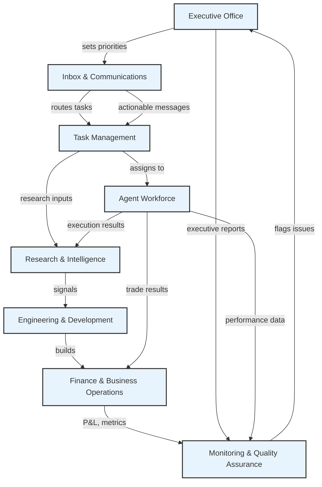

# Eight-Department Capability Matrix

**Based on**: Master System Prompt Section 3 (Eight Departments of the AI Office)  
**Generated**: 2026-11-23  
**Purpose**: Discovery audit — map each department to existing infrastructure, gaps, and integration status

---

## Department Mapping vs. Current Infrastructure

| # | Department (from Prompt) | Current Status | Key Existing Files | Autonomy Tier (from Charter) | Gaps / Missing integrations |
|---|---|---|---|---|---|
| **1** | **Executive Office** | ✅ Partial | `COMPANY_CHARTER.md`, `company.py` (launcher), `NEXT_100_TASKS.md` | A (autonomous) — CEO coordinator role | • No priority management system • No strategic planning interface • Daily executive reports not generated |
| **2** | **Inbox & Communications** | ✅ Partial | `_office/inbox/` (60+ items: alerting.md → weekly-reviewer.md), `_office/BOARD.md` | B (gated) — Incoming instructions processor | • No classification pipeline (INFORMATIONAL/ACTIONABLE/AWAITING APPROVAL/IN PROGRESS/RESOLVED/DUPLICATE/BLOCKED) • No duplication detection • No actionable message extraction from conversations |
| **3** | **Task Management** | ⚠️ Partial | `company_dispatcher.py` (keyword routing), `company.py` (dispatch command), task IDs generated per-dispatch (`c-<8hex>`) | B (gated) — Central task registry | • No central task registry with persistent IDs • No dependency tracking between tasks • No deadline assignment • No completion verification mechanism • No status history (disappears silently after dispatch) |
| **4** | **Agent Workforce** | ⚠️ Partial | `.openalice-fleet/`, JEV 32-agent dispatcher (`jev-dispatcher.py`), `.agents/` directory, `dost.py` (320+ tests) | C (human gate) — Agent discovery & assignment | • No agent capability mapping (what each agent can do) • No workload distribution algorithm • No agent health monitoring • No idle-session detection • No failure recovery workflow • Session control panel (React) not integrated |
| **5** | **Research & Intelligence** | ✅ Partial | `research/` department (hypothesis queue, backtests, gates), `o3_runner.py` references, `hypothesis_queue.py` | A (autonomous) — Research & Information gathering | • No evidence collection system with sources • No fact-checking pipeline • No decision support with verified/hypothesis/distinction • No competitor analysis workflow • No documentation template for research findings |
| **6** | **Engineering & Development** | ⚠️ Partial | `assistant` department (code generation, review, refactoring), `all_in_one_bot.py`, `execution_engine.py`, 30+ backtest scripts | A (autonomous) — Software development | • No code review pipeline with independent second model verification • No testing automation beyond pytest (100+ passing but isolated) • No API integration framework documented • No deployment preparation workflow • No infrastructure maintenance automation |
| **7** | **Finance & Business Operations** | ⚠️ Partial | `ops` department (P&L, tiers, health, dashboards), `jev-dispatcher.py --pnl`, `office_pnl.json` (home dir), metrics at `http://127.0.0.1:8083` | B (gated) — Financial reporting & metrics | • No real-time expense analysis • No budget tracking beyond paper ledger • No resource utilization metrics • No efficiency analysis workflow • Cost cap in `office.json` is warning-only, never halts dispatch • P&L ledger exists but not integrated with task outcomes |
| **8** | **Monitoring & Quality Assurance** | ⚠️ Partial | Dashboard at localhost:3000 (session control panel), metrics endpoint `http://127.0.0.1:8083`, `observability.py`, `prometheus.yml` | B (gated) — Continuous health monitoring | • No task verification workflow (task is not complete merely because agent says it is) • No regression detection • No incident reporting mechanism • No failure detection beyond basic error logs • No operational audits workflow • No regression detection between agent upgrades |

---

## Department Status Summary

| Department | Working Code | Test Coverage | Integration Status | Risk Level |
|---|---|---|---|---|
| Executive Office | ✅ launcher + charter | N/A | ❌ No priority/reporting system | Low (paper-only) |
| Inbox & Communications | ✅ 60+ inbox items | N/A | ❌ No classification pipeline | Medium |
| Task Management | ✅ dispatcher + UUIDs | N/A | ❌ No central registry | Medium |
| Agent Workforce | ⚠️ JEV 32-agent fleet | ⚠️ Unknown | ❌ No panel integration | High (Tier C human gate) |
| Research & Intelligence | ✅ hypothesis queue + backtests | ⚠️ Partial | ❌ No evidence/source tracking | Low (paper-only) |
| Engineering & Development | ⚠️ Assistant + scripts | ✅ 100+ passing tests | ❌ No API/deployment framework | Medium |
| Finance & Business Ops | ⚠️ P&L + metrics | N/A | ❌ No budget/efficiency tracking | Low (paper-only) |
| Monitoring & QA | ⚠️ Dashboard + metrics API | N/A | ❌ No verification/incident workflow | Medium |

---

## Cross-Department Dependency Map

---

## Integration Priority Matrix

| Department | Integration Effort | Impact if Integrated | Safety Concern | Priority |
|---|---|---|---|---|
| Inbox & Communications | Medium | High (all tasks enter through here) | Low (classification only) | **P0** — First phase |
| Task Management | High | High (task flow backbone) | Medium (dependency tracking) | **P1** — Phase 2 |
| Agent Workforce | High | High (enables agent assignment) | High (Tier C human gate) | **P1** — Phase 2 (with gating) |
| Research & Intelligence | Medium | Medium | Low (paper-only) | **P2** — Phase 3 |
| Engineering & Development | Medium | Medium | Low | **P2** — Phase 3 |
| Finance & Business Ops | Medium | Medium | Low (paper-only P&L) | **P3** — Phase 4 |
| Monitoring & QA | High | High (quality gate) | Medium (verification loop) | **P3** — Phase 4 |
| Executive Office | Low | Medium | Low | **P4** — Phase 5 |

---

## Eight-Department Gap Prioritization

**P0 (Immediate — Inbox & Communications)**:  
Classification pipeline for _office inbox items → AI-Office department routing. This is the entry point for all work.

**P1 (High — Task Management + Agent Workforce)**:  
Central task registry with persistent IDs + agent capability mapping. Without this, no coordinated work across departments.

**P2 (Medium — Research + Engineering)**:  
Evidence tracking for research + code review pipeline. Supports the intelligence loop.

**P3 (Lower — Finance + Monitoring)**:  
P&L integration + verification workflow. Can be built after the core flow is established.

**P4 (Optional — Executive Office)**:  
Priority management + executive reports. High-level orchestration, can be last.

---

*End of Eight-Department Capability Matrix*