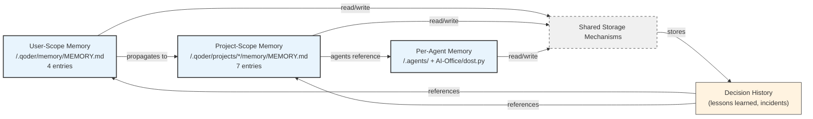

# Memory Architecture

**Based on**: Master System Prompt Section 7 (Shared Office Memory), Section 15 (Make the Office Real)  
**Generated**: 2026-11-23  
**Purpose**: Discovery audit — memory architecture for unified AI Office

---

## Memory Architecture Overview

Per Section 7 of the master prompt, the office needs five types of shared organizational memory:

1. **Company memory** — Relevant to the entire office
2. **Department memory** — Relevant to a specific department
3. **Project memory** — Relevant to an ongoing project
4. **Agent memory** — Relevant to an individual agent
5. **Decision history** — Lessons learned, incident history

---

## 1. User-Scope Memory

### Location: `/Users/aryanagarwal/.qoder/memory/MEMORY.md`

| Entry | Type | Description |
|---|---|---|
| `feedback-automated-analysis-bots` | Feedback | User wants fully automated, one-command analysis bots; no manual steps or partial execution |
| `feedback-no-recap-on-resumption` | Feedback | Resume directly after context breaks, no recap or "I'll continue" preface |
| `feedback-no-stock-timing-advice` | Feedback | Decline stock-timing/directional calls; not SEBI-registered advisor; factual analysis only |
| `nse-paper-ticket-2026-11-16` | Project | Runner + NIFTY 50 screen implemented; ADANIGREEN short → IREDA long retest; TMPV.NS short only screen pass (R=1.52) |

**Total entries**: 4 (as of 2026-11-23)  
**Purpose**: User-specific preferences and constraints that persist across conversations

### Memory Rules (from auto-memory system)

| Rule | Description |
|---|---|
| **Keep each MEMORY.md index concise** | No more than 200 lines |
| **Keep name, description, type fields up-to-date** | Regular maintenance required |
| **Organize semantically, not chronologically** | Group by topic, not by date |
| **Update/remove stale memories** | Remove or update wrong/outdated entries |
| **Do not write duplicate memories** | First check existing before writing new |

### User-Scope Memory Access

- **Read**: Always authorized (permitted by session configuration)
- **Write**: Via Write tool, with frontmatter format (name, description, metadata.type)
- **Index**: Pointer in MEMORY.md (one line per entry, ~150 characters)
- **Provenance**: Timestamps and ownership preserved

---

## 2. Project-Scope Memory

### Location: `/Users/aryanagarwal/.qoder/projects/-Users-aryanagarwal/memory/MEMORY.md`

| Entry | Type | Description |
|---|---|---|
| `Fundamentals Cross-Repo Wiring` | Project | Same read-only fundamentals flow to 16 trading bots across AI-Office, openalice-fleet, agent-workspaces/crypto via producer-published alias map; 100+ tests passing; enhancements: launchd producer (06:00 UTC), position sizing modifier, mtime caching, path-order safe reader, screener columns, AlphaInsider allocation + paper sizing, oa_scalp100 risk guard (0.2-1.0×), combined_portfolio_feed enrichment |
| `Session Control Panel Fix` | Project | Fixed React app at localhost:3000: renamed index.js→index.tsx, added missing SessionList/SessionDetail/components, mock data (all_stocks_bot.py), and Tailwind CSS; now displays 3 mock sessions with OpenClaw/OpenCode adapters and transcripts |
| `Unified Dashboard Goal` | Project | Goal to build all-in-one dashboard consolidating session control, trading bot monitoring, fundamentals data, and system health; design spec (2026-11-23-unified-dashboard-design.md) + implementation plan (2026-11-23-unified-dashboard-plan.md) with 8 phases, 32 tasks; unified API layer (Fastify, port 4749) begun |
| `Unified Assistant Mode` | Project | Unified command routing to 10 specialized, paper/testnet-only departments |
| `Advisory cost cap` | Project | Daily fleet cost ceiling lives in office.json `cost_cap`, warning-only, never halts dispatch |
| `Indian mythology reels (v9)` | Project | v9 pipeline complete: 5 reels built + verified, ads creatives generated against v9 outputs |
| `Session control panel live config attempt` | Project | User attempted to integrate live OpenClaw/OpenCode API keys into the session control panel; OpenCode key provided but OpenClaw key not available, so mock/placeholder configuration was used |
| `Dost project progress` | Project | Progress update on building dost as a proactive multi-modal autonomous research agent; universal interfaces, persistent memory, skill system, fleet orchestration; 320+ tests passing; security constraints maintained |

**Total entries**: 7 (as of 2026-11-23)  
**Purpose**: Project-specific state that persists across conversations — what who is doing what, why, or by when

### Project-Scope Memory Rules

| Rule | Description |
|---|---|
| **Convert relative dates to absolute dates** | E.g., "Thursday" → "2026-11-05" so memory remains interpretable |
| **Keep index ≤ 200 lines** | Concise index, one line per entry <~150 characters |
| **Organize semantically** | By topic, not chronologically |
| **Update/remove outdated memories** | Memories decay fast; "why" helps future-you judge relevance |
| **Do not duplicate memories** | First check existing before writing new |

### Project-Scope Memory Access

- **Read**: Authorized for this project context
- **Write**: Via Write tool, frontmatter format with name/description/metadata (type: project)
- **Index**: MEMORY.md with one-line entries under ~150 characters
- **Linked knowledge**: Entries may list parent/related/sub/version/similar entries; follow up with fetch mode

---

## 3. Per-Agent Memory

### Location: `/Users/aryanagarwal/.agents/` (and subdirectories)

| Agent Type | Memory Path | Content |
|---|---|---|
| **OpenCode agents** | `~/.Codex/agents/*.md` | Agent runtime definitions, capabilities, health status |
| **Qoder CLI agents** | `.qoder/` + plugins | CLI-installed agent definitions, extensions |
| **Dost agents** | `AI-Office/dost.py` | Skill system, universal interfaces, persistent memory, fleet orchestration |

**Per-agent memory should contain**:
- Agent capabilities (what it can do)
- Current workload (active tasks, idle status)
- Failure history and recovery status
- Preference settings (model preferences, autonomy tier)
- Last successful execution timestamp

**Current state**: Partially documented — `.agents/` directory exists but contents not fully inspected. Per Section 4 of master prompt: "AGENT MEMORY — Relevant to an individual agent. Never assume that an agent's private memory is automatically visible to other agents. Use an explicitly supported shared storage mechanism."

---

## 4. Shared Storage Mechanisms

### Current Shared Storage

| Storage Type | Path | Content | Access |
|---|---|---|---|
| **User MEMORY.md** | `/Users/aryanagarwal/.qoder/memory/MEMORY.md` | 4 entries (user preferences, constraints) | Read/write via Qoder session |
| **Project MEMORY.md** | `/Users/aryanagarwal/.qoder/projects/-Users-aryanagarwal/memory/MEMORY.md` | 7 entries (project state, progress) | Read/write within project scope |
| **Company log** | `AI-Office/logs/company.log` | Timestamped operation log | Append-only via company_dispatcher.py |
| **Tasks database** | `AI-Office/packages/office-core/tasks.db` | SQLite task registry | Read/write via office-core workers |
| **Prometheus metrics** | `http://127.0.0.1:8083/metrics` | Real-time operational metrics | Read-only via HTTP endpoint |
| **Git repository** | `AI-Office/` (main branch) | Code history, manifests, changelog | Read/write via git |

### Shared Storage Gaps

| Gap | Risk | Required |
|---|---|---|
| **No cross-scope memory bridge** | User-scope and project-scope memories not synchronized | Create bridge protocol: propagate changes between `.qoder/memory/` and `.qoder/projects/*/memory/` |
| **No agent memory visibility** | Per master prompt: "Never assume that an agent's private memory is automatically visible to other agents" | Explicit shared storage mechanism per agent |
| **No provenance tracking** | Per Section 7: "Preserve provenance, timestamps and ownership" | Add timestamps + ownership to all memory entries |
| **No versioned memory** | Memories can decay or become outdated | Version each memory entry; support rollback |
| **No deletion/merge protocol** | Removing stale memories could lose context | Document when and how to remove/update memories |

---

## 5. Decision History (Required per Section 7)

Per the master prompt Section 7, the office needs "Decision history" and "Lessons learned."

### Decision History Gaps

| Decision | Date | Department | Outcome | Evidence |
|---|---|---|---|---|
| First infrastructure audit | 2026-11-23 | Executive Office → Task Management → Research | Discovery of 8-department gaps | This session's deliverables (infrastructure-map.md, department-matrix.md, etc.) |
| Model routing enhancement | Pending | Engineering & Development | Will add intelligent model router | Not yet implemented |
| Inbox classification pipeline | Pending | Inbox & Communications | Will classify 60+ items per Section 2 | Not yet implemented |
| Task registry centralization | Pending | Task Management | Will create persistent task IDs | Not yet implemented |

**Decision History Format** (required, not yet implemented):

| Field | Type | Description |
|---|---|---|
| `decision_id` | UUID | Persistent identifier |
| `decision_date` | ISO timestamp | When decision was made |
| `decision_by` | String | Who/which department made the decision |
| `objective` | Text | What decision was about |
| `options_considered` | Array | Alternatives evaluated |
| `choice_made` | Text | What was chosen |
| `rationale` | Text | Why this choice (evidence-based) |
| `outcome` | Text | What actually happened after decision |
| `lessons_learned` | Text | What would be done differently |
| `related_memories` | Array of memory IDs | Which MEMORY.md entries relate to this decision |

---

## 6. Memory Architecture Complete Diagram

---

## 7. Memory Architecture Summary

### What Works (Verified)
- **User-scope MEMORY.md**: 4 entries, persistent across conversations
- **Project-scope MEMORY.md**: 7 entries, persists across conversations, semantic organization
- **Shared log file**: `AI-Office/logs/company.log`, append-only
- **Git repository**: Full code history with provenance
- **Prometheus metrics**: Real-time operational data at `http://127.0.0.1:8083`

### What's Missing (Gaps)
- **No cross-scope bridge**: User-scope and project-scope memories not synchronized
- **No agent memory protocol**: Per master prompt Section 7: "Never assume that an agent's private memory is automatically visible to other agents"
- **No decision history**: No structured record of decisions made, outcomes, lessons learned
- **No provenance on memory entries**: No timestamps or ownership on most MEMORY.md entries
- **No versioned memory**: Memories can decay; no rollback mechanism
- **No memory validation**: No verification that memory entries are still correct/up-to-date

### Priority Implementation Order

1. **P0**: Cross-scope memory bridge (sync user-scope ↔ project-scope MEMORY.md)
2. **P1**: Agent memory protocol (per Section 7: explicit shared storage mechanism)
3. **P2**: Decision history registry (structured decisions + outcomes + lessons)
4. **P2**: Provenance tracking (timestamps + ownership on all memory entries)
5. **P3**: Memory validation (periodic check that entries are still correct)

### Implementation Next Steps (per Section 15)

Per the master prompt: "Then begin implementing the highest-value safe improvements in isolated, testable stages."

**Phase 1 — Memory Bridge** (non-destructive):
- Create sync script between `.qoder/memory/MEMORY.md` and `.qoder/projects/*/memory/MEMORY.md`
- Validate entries propagate without corruption
- Test: Add entry to user-scope, verify in project-scope (and vice versa)

**Phase 2 — Decision History** (non-destructive):
- Create `decisions.jsonl` or SQLite table with decision_id, date, department, objective, outcome, lessons
- Test: Record a decision from this session, verify persistence

**Phase 3 — Agent Memory Protocol** (non-destructive):
- Document per-agent memory format in `.agents/` or `AI-Office/dost.py`
- Test: Read agent capability info and verify it's complete

---

*End of Memory Architecture*